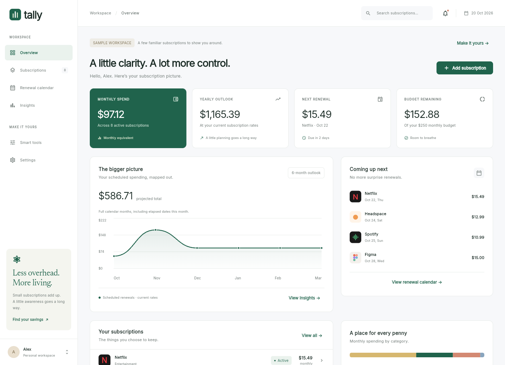

# Tally

A Flutter subscription monitor for keeping recurring spending, renewal dates, and everyday financial decisions in one place. Tally uses a restrained green and neutral palette, bundled typography, responsive layouts, and a private local workspace.



## What works

- **Overview:** monthly equivalent, annual commitment, next renewal, budget remaining, scheduled spending chart, upcoming charges, and category breakdown.
- **Subscription library:** add, edit, search, filter, sort, pause, resume, cancel tracking, and delete; weekly, monthly, quarterly, and yearly billing; trials, notes, provider links, and individual reminder preferences.
- **Renewal calendar:** month navigation, marked renewal dates, selected-day details, monthly totals, and 12-month calendar export with alarms.
- **Insights:** category mix, budget progress, billing-cycle comparisons, largest commitments, and six-month scheduled charges.
- **Smart tools:** monthly-versus-annual comparison, a bill splitter that preserves every cent, and a hypothetical savings planner.
- **Data controls:** JSON backup/restore, CSV export, calendar export, profile preferences, currency selection, sample-data reset, and recoverable persistence errors.
- **Offline web app:** bundled fonts and CanvasKit, a versioned offline cache, installable web manifest, and local storage. Offline reload works after the first successful load and cache installation.

The first launch contains **clearly labeled sample subscriptions**. Use **Settings → Clear subscriptions** to start your own workspace. The demo contains illustrative USD prices, not live provider prices.

## Run

Flutter **3.35.7** / Dart **3.9.2** is the tested toolchain, pinned in `.flutter-version` and `.fvmrc`. Android also needs a full JDK 17 or 21 and the Android SDK; iOS needs macOS, Xcode, and CocoaPods.

```bash
flutter pub get --enforce-lockfile
flutter run -d chrome
# Or choose an attached Android/iOS device:
flutter devices
flutter run -d <device-id>
```

In the prepared Codex cloud workspace:

```bash
cd /workspace/Subscription-monitoring-app
source tool/cloud_env.sh
```

Each cloud task already has an isolated checkout. Use it directly; do not create another Git worktree unless explicitly requested.

## Validate and build

```bash
flutter analyze --no-pub
flutter test --no-pub --coverage
bash tool/build_web.sh
python3 -m http.server 8080 --directory build/web
```

`tool/build_web.sh` compiles the release app with local rendering resources, then generates the offline cache using Python 3. Deploy the **whole `build/web` directory** over HTTPS. For a subdirectory, pass `--base-href /your-path/` to the build script. Do not open `index.html` directly as a local file. Serve `index.html`, `flutter_bootstrap.js`, and `sw.js` with revalidation (`Cache-Control: no-cache`) so clients can discover updates. A new service worker takes over after older tabs close; user data is independent of the asset cache.

The optional real-browser checks use Node.js and Chromium:

```bash
npm ci --prefix tool/browser --ignore-scripts
# Keep the server above running, then:
npm test --prefix tool/browser
```

Set `CHROMIUM_PATH` for a nonstandard Chromium executable or `TALLY_BASE_URL` for a different test server. The checks create isolated browser profiles, exercise actual downloads/imports and offline reloads, and save screenshots under `docs/screenshots`. Generated export files stay in ignored `tool/browser/results`.

CI is configured in `.github/workflows/ci.yml` for formatting, static analysis, tests, a web release build, and an Android debug build. CI runs when the project is pushed; its configuration does not imply that GitHub Actions has already run.

## Android and iOS releases

For Android development:

```bash
flutter build apk --debug
```

Android release builds require your own signing key. Provide these variables securely in the build environment; do not commit their values or the keystore:

- `TALLY_KEYSTORE_PATH` — absolute path to your keystore
- `TALLY_KEYSTORE_PASSWORD`
- `TALLY_KEY_ALIAS`
- `TALLY_KEY_PASSWORD`

Then run `flutter build appbundle --release`. The Gradle configuration refuses release tasks without signing configuration, including those selected by aggregate `assemble` or `build` commands. Debug-only builds remain available. Set your own unique application/bundle identifier before publishing (`app.tally.tally` is the project default).

For iOS, open `ios/Runner.xcworkspace` on a Mac, select your development team and bundle identifier, then run `flutter build ipa`. Test file import/export, calendar import, provider links, and accessibility on physical devices before store submission. Native permissions, signing, store metadata, and publication remain the owner's responsibility; this repository does not publish automatically.

## Data and calculations

Amounts are stored as integer hundredths of the selected currency. Monthly equivalents use annual ÷ 12, quarterly ÷ 3, and weekly × 52 ÷ 12. Annual totals are derived without rounding each subscription. Scheduled calendar charges use real renewal occurrences instead, so their totals can differ from normalized equivalents. Forecasts cover full calendar months, including elapsed dates in the current month; they are **not payment history**.

Month-end and leap-day renewals retain their original day anchor. A January 31 plan renews on February's last day and returns to March 31. Trial dates represent the first paid renewal, and trial prices are included in future commitments. Paused and cancelled plans are excluded from projections. A zero budget is a zero-spend target.

A workspace uses one currency: USD, EUR, GBP, CAD, AUD, PKR, INR, JPY, CHF, AED, or SGD. Currency changes require an empty subscription list. Tally does not perform exchange-rate conversion; all currencies currently use two-decimal input and display, including JPY.

The versioned local state supports up to 1,000 subscriptions and an 8 MiB serialized limit (browser storage quotas can be smaller). Names, dates, amounts, enums, URLs, duplicate IDs, and backup sizes are validated. Writes are serialized; failed saves keep the last committed UI state. Invalid stored content is preserved for recovery instead of silently replaced. Imports validate the complete backup before replacing anything. CSV exports neutralize spreadsheet formulas; calendar exports escape and fold UTF-8 content.

Tally has no backend, account login, bank sync, analytics, billing API, or automatic provider cancellation. Calendar reminders require importing the `.ics` file into a calendar app and enabling alerts there; they do not provide native background push notifications. Exports do not stay synchronized after edits. Data and JSON backups are not encrypted by Tally. Browser data clearing, app removal, or device loss can remove a workspace; keep backups. Device-level backup settings may apply independently of Tally.

## Project map

| Path | Responsibility |
| --- | --- |
| `lib/core/models.dart` | Validated models, money normalization, anchored recurrence |
| `lib/core/app_store.dart` | State, persistence, demo, backup/CSV/calendar export |
| `lib/core/file_transfer.dart` | Native sharing and browser file downloads |
| `lib/ui/design.dart` | Shared theme, type, colors, components, service marks |
| `lib/ui/app_shell.dart` | Responsive navigation, inbox, search, recovery messages |
| `lib/ui/*_page.dart` | Overview, library, calendar, insights, tools, settings |
| `test/` | Domain, persistence, and responsive interaction tests |
| `tool/` | Build, offline cache, cloud initialization, browser checks |

Inter, Newsreader, and Roboto are bundled with their SIL Open Font Licenses in `assets/fonts`. Provider names and illustrative marks identify subscriptions; Tally is not affiliated with those providers.

See [validation notes](docs/VALIDATION.md) for the checks actually completed in this environment and remaining platform limits.
